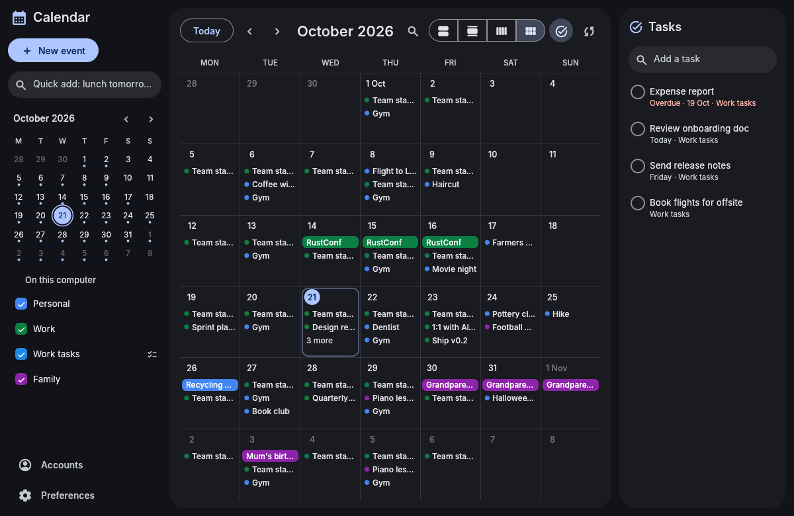
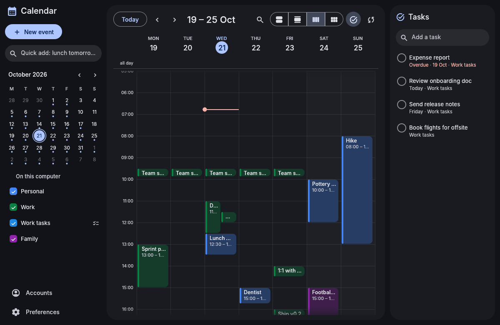
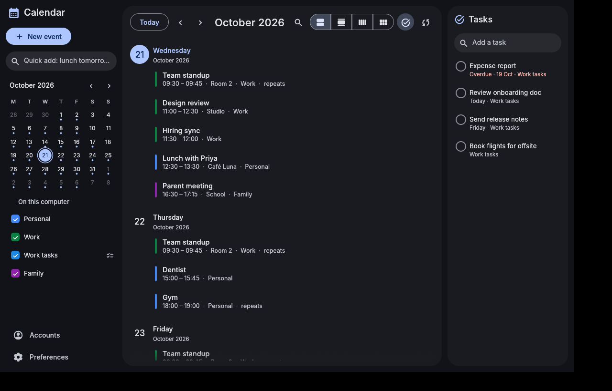
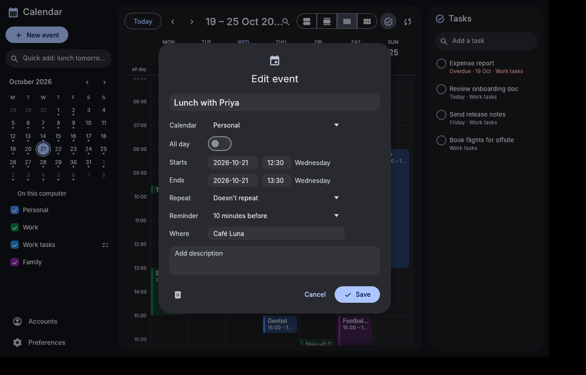
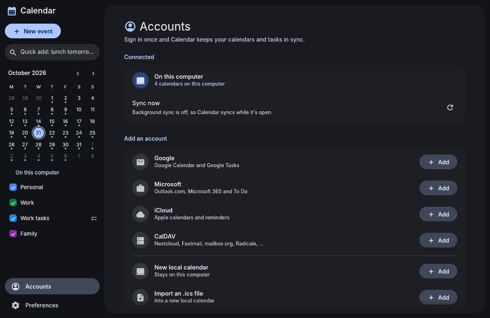

# Material 3 Calendar

A calendar for Arch Linux and CachyOS, built with [egui](https://github.com/emilk/egui) and themed with Material You. It shares its look with the other Material 3 apps through [material-3-ui](https://github.com/bhimio1/material-3-ui), and on an [end4-pC](https://github.com/bhimio1/end4-pC) desktop it takes its colors from your wallpaper, live.

Add an account by signing in through your browser, and Calendar takes it from there. A small background service keeps a local copy of everything, so the app opens instantly and works offline. It also shows reminders and answers the shell over D-Bus. You don't have to set up CalDAV URLs by hand.







## Features

- **Accounts:**
  - **Google** (Calendar and Tasks) and **Microsoft** (Outlook.com, Microsoft 365, To Do): sign in through the browser (OAuth with PKCE and a loopback redirect);
  - **iCloud**: with an app-specific password;
  - **any CalDAV server** (Nextcloud, Fastmail, mailbox.org, Radicale, …): from just the server address, using `.well-known` and principal discovery;
  - **local calendars**: stored only on this computer, with `.ics` import and export.
- **Views:** month, week, day and agenda; a mini month; per-calendar colors and visibility; search across two years. The week and day time grid has an all-day row and a now line.
- **Quick add:** type `Lunch with Sam tomorrow 1pm at Café Luna for 90 min`, `Standup every weekday 9:30-9:45am` or `Mum's birthday oct 30`. The same parser understands times in the editor (`1:30pm`, `noon`).
- **Editing:** title, calendar, all-day, start and end, repeat (daily, weekdays, weekly, monthly, yearly), reminder, place and notes. For a repeating event, you can delete one occurrence or the whole series. Deletes can be undone.
- **Tasks:** Google Tasks, Microsoft To Do and CalDAV VTODO lists, shown in a side pane. Add a task (`Pay rent friday` sets the due date) or check it off.
- **Reminders:** desktop notifications with **Open** and **Snooze 10 min**, even when the window is closed.
- **Sync:** incremental. Google uses sync tokens, Microsoft Graph uses delta links, and CalDAV uses sync-collection with an etag comparison fallback. Edits are queued and sent on the next sync, so offline changes are kept. If a CalDAV event changed on the server in the meantime, the server's copy wins.
- **Keyboard:** <kbd>T</kbd> today, <kbd>←</kbd>/<kbd>→</kbd> previous/next, <kbd>N</kbd> new event, <kbd>1</kbd>–<kbd>4</kbd> month/week/day/agenda, <kbd>Esc</kbd> closes the editor.
- **Secrets:** refresh tokens and passwords are kept in your keyring (Secret Service through `secret-tool`), never in a file.

## Install

From the AUR, prebuilt or built from source:

```sh
paru -S material-3-calendar-bin   # or material-3-calendar-git
systemctl --user enable --now m3-calendar.service   # sync and reminders in the background
```

On end4-pC, install it from **Material 3 Settings → Material 3 apps**. Settings downloads the release, copies `share/` into `~/.local/share`, and enables the service.

Or build it yourself:

```sh
cargo build --release
./target/release/m3-calendar
```

Runtime needs: `libsecret` (for `secret-tool`) plus a Secret Service keyring (GNOME Keyring, KeePassXC or KWallet), `xdg-utils`, and a notification daemon (the end4-pC shell has one). `zenity` is optional, for the file picker when importing `.ics` files.

### Google and Microsoft sign-in

Google and Microsoft only allow sign-in through an OAuth client that is registered with them. This project doesn't ship anyone's client ID, so you register your own. It's free and takes a few minutes. **Accounts → Add** walks you through it:

- **Google:** in Google Cloud Console, create a project and enable the *Google Calendar API* and the *Google Tasks API*. Set up the OAuth consent screen (External) and add yourself as a test user. Then create an *OAuth client ID* of type *Desktop app* and paste its ID and secret into Calendar. The secret goes into your keyring.
- **Microsoft:** in Azure, open *App registrations → New registration* and allow personal and work accounts. Add the redirect URI `http://localhost` (type *Public client/native*), then paste the *Application (client) ID* into Calendar.

You can also set the client IDs in Preferences, or with `M3_CALENDAR_GOOGLE_CLIENT_ID` and `M3_CALENDAR_MS_CLIENT_ID`.

## For the shell

### Command line

```
m3-calendar [--view month|week|day|agenda] [--date YYYY-MM-DD] [--page accounts|preferences]
m3-calendar --open EVENT_ID [--at UNIX_TIME]      open the app on an event
m3-calendar events [--from DATE] [--to DATE] [--json]   DATE: YYYY-MM-DD, today, tomorrow, yesterday (inclusive)
m3-calendar agenda [--days N] [--json]            what's left today and the next N-1 days (default 7)
m3-calendar add "Lunch tomorrow 1pm" [--calendar ID] [--json]
m3-calendar tasks [--json]
m3-calendar calendars [--json]
m3-calendar sync
m3-calendar import FILE.ics
m3-calendar export CALENDAR_ID FILE.ics
m3-calendar daemon                                (also --daemon)
```

The commands ask the daemon over D-Bus when it's running. Otherwise they read the cache directly, so the output is the same either way.

### D-Bus

The daemon owns `org.material3.Calendar` on the session bus, at object `/org/material3/Calendar` with interface `org.material3.Calendar`. A D-Bus activation file starts it on demand when it was installed from a package.

| Method | Arguments | Returns |
|---|---|---|
| `ListCalendars` | – | JSON array of calendars |
| `GetEvents` | `from: x`, `to: x` (unix seconds) | JSON array of occurrences overlapping `[from, to)` in visible calendars |
| `GetTasks` | – | JSON array of open tasks |
| `CreateEvent` | `json: s` (an event, see below) | `s`, the new event's id |
| `UpdateEvent` | `json: s` (`id` plus the fields to change) | – |
| `DeleteEvent` | `id: s` | – |
| `QuickAdd` | `text: s` | JSON of the new event |
| `CompleteTask` | `id: s` | – |
| `SyncNow` | – | – (the sync runs in the background) |
| signal `Changed` | – | sent after every change to the cache |

An occurrence looks like this:

```json
{"key": "…@1792654200", "event_id": "…", "calendar_id": "local/…", "calendar": "Work", "color": "#0B8043",
 "title": "Team standup", "location": "Room 2", "description": "", "start": 1792654200, "end": 1792655100,
 "all_day": false, "recurring": true, "reminders": [5],
 "start_iso": "2026-10-22T09:30:00+02:00", "end_iso": "2026-10-22T09:45:00+02:00"}
```

All-day events start at 00:00 UTC on their first day, and their `end` is exclusive. Their `start_iso` and `end_iso` are plain dates, and `end_iso` is the last day. For `CreateEvent`, give `title`, `start` and `end` (unix seconds). Optional fields are `calendar_id` (the default calendar otherwise), `all_day`, `location`, `description`, `rrule` (e.g. `FREQ=WEEKLY;BYDAY=MO`), `tz` (IANA name, the local zone otherwise) and `reminders` (minutes before).

```sh
busctl --user call org.material3.Calendar /org/material3/Calendar org.material3.Calendar GetEvents xx 1792620000 1792706400
```

## Files

| What | Where |
|---|---|
| Cache (SQLite, shared by the app, the daemon and the CLI) | `~/.local/share/m3-calendar/cache.db` |
| Preferences | `~/.config/m3-calendar/config.toml` |
| Accounts (no secrets) | `~/.config/m3-calendar/accounts.toml` |
| Tokens and passwords | your keyring, `service=m3-calendar` |
| Background service | `m3-calendar.service` (systemd user unit) |

## Project layout

```
src/
  main.rs        app / daemon / CLI entry
  cli.rs         the command line
  daemon.rs      sync loop, reminders (notifications with Snooze/Open)
  dbus.rs        org.material3.Calendar service and client
  store.rs       the SQLite cache, occurrences, pending edits
  sync.rs        push-then-pull sync, accounts, .ics import/export
  ops.rs         edits shared by the app, D-Bus and CLI
  providers/     google.rs, microsoft.rs, caldav.rs (+ the WebDAV XML tree)
  ical.rs        iCalendar reader/writer
  recur.rs       RRULE expansion (rrule crate, per-event time zones)
  nlp.rs         quick add
  config.rs      preferences and account metadata
  ui/            sidebar, views (month, time grid, agenda), editor, tasks, accounts, preferences
packaging/       PKGBUILD (-git), aur/PKGBUILD-bin, desktop file, systemd and D-Bus service files
```

Run the tests with `dbus-run-session -- cargo test`. The providers are tested against mock servers, and the D-Bus test needs a session bus.

## License

MIT, see [LICENSE](LICENSE). Fonts: Inter (SIL OFL 1.1, see `assets/LICENSE-Inter.txt`). Icons: Material Symbols, via `egui_material_icons`.
